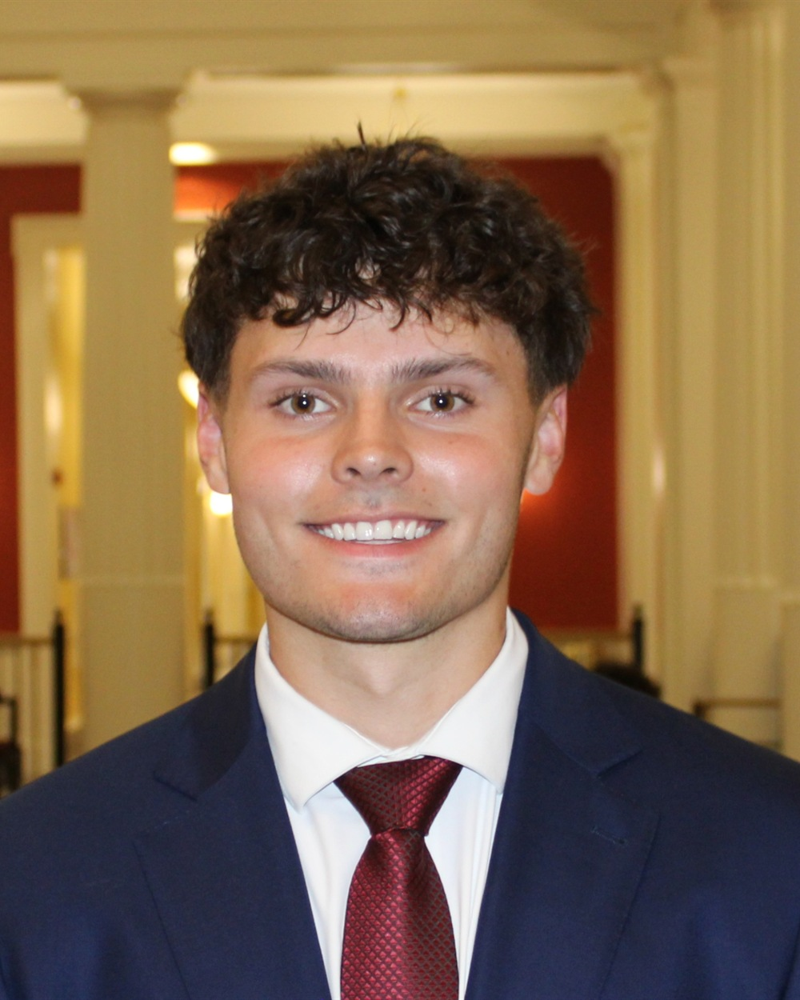

# RedHawk Applied AI — Website

Static site. No build step, no dependencies, no framework.

```
index.html        the whole site: how it works, second semester, RedHawk Builds, exec, members, apply, work with us
members.html      redirect to the members section (old link)
members-data.js   the roster and weekly curriculum content (edit this one)
members.js        draws the roster and curriculum from members-data.js
styles.css        design system + layout
script.js         scroll behavior, nav, motion
assets/           images
IMAGES.md       what image goes where + sourcing guide
```

---

## Preview locally

```bash
python -m http.server 5173 --directory "C:\Users\ryan5\redhawk-website"
```

Then open <http://localhost:5173>.

> Open it through the server, not by double-clicking `index.html`. The `file://`
> protocol blocks the Google Form iframe.

---

## Before launch — the four things that need real content

### 1. Applications, roster, and curriculum
The interest form is gone. The `#apply` section in `index.html` says applications
reopen in February; when they do, swap that section's buttons for the application link.

**Roster and weekly curriculum** both live in `members-data.js`:

- `ROSTER`: one line per member (`name`, `detail`, `linkedin`, `photo`). Empty seats
  show as "Coming soon" up to `ROSTER_SEATS` (24).
- `CURRICULUM`: one entry per week, in order. Replace a `{ tba: true }` entry with a
  `title`, `summary`, and `sections` to announce that week. The hackathon is the entry
  marked `event: true`.

Weeks are numbered automatically from their order, so nothing else needs renumbering.

### 2. The logo
Save your real logo (white circle version) to `assets/logo.png`, then update the two
`` references in `index.html` — one in the nav, one in the
footer. SVG is better than PNG if you have the vector file.

### 3. The hero campus photo
Save to `assets/hero-campus.jpg` and update the hero `` src.
**See `IMAGES.md`** — use a real photo, not an AI-generated one.

### 4. Exec headshots — ✅ 10 of 10 done
All ten headshots are live in `assets/team/`. Will Beinecke and Kaelynn Smith have no
LinkedIn button yet (the `no-link` class on their cards); add the `<a class="li">` block
from another card and drop `no-link` once you have their links.

To add one: drop the photo in `Downloads`, add them to the `$map` in
`process-headshots.ps1`, run it, then update their `<article class="member">` block to
match the other eight.

**Adjusting a crop.** Each headshot was auto-cropped to 4:5 from a differently-shaped
source. If someone's face sits too high or low in their card, add a focus override to
that one `` — no other change needed:

```html

```

Second value is the vertical anchor: **lower % = more headroom above the face**,
higher % = more chin/shoulders. Default is `50% 28%`.

---

## Deploying to Vercel

Because it's a static site with no build step, this is about as simple as it gets.

**Option A — drag and drop (fastest)**
1. Go to <https://vercel.com/new>
2. Drag the `redhawk-website` folder onto the page
3. Framework preset: **Other**. Leave build command and output directory empty.
4. Deploy.

**Option B — Git (better, gives you auto-deploy on every push)**
1. Push this folder to a GitHub repo
2. Vercel → New Project → import the repo
3. Framework preset: **Other**, no build command, output directory `.`
4. Deploy. Every push to `main` redeploys automatically.

**Custom domain:** Vercel dashboard → Project → Settings → Domains. If Miami provides
a subdomain you'll need a CNAME record; a `.org` or `.club` domain runs about $10–15/yr.

---

## Design system reference

Change these in one place — the `:root` block at the top of `styles.css`.

| Token | Value | Used for |
|---|---|---|
| `--paper` | `#FDFCFA` | primary light background |
| `--paper-tint` | `#F4F1EC` | alternating light band |
| `--ink` | `#15161A` | dark bands + footer |
| `--red` | `#C8102E` | Miami red — primary accent |
| `--t1` / `--t2` / `--t3` | text on light | heading / body / muted |
| `--d1` / `--d2` / `--d3` | text on dark | heading / body / muted |

**Type:** Plus Jakarta Sans (headings) · Inter (body) · Instrument Serif (italic accents)

**Section rhythm** — deliberately alternating so it doesn't read as one flat scroll:
`hero (photo) → light → tint → DARK → light → tint → DARK → footer`

---

## Accessibility notes

Verified in-browser, not assumed:

- All body/muted text meets **WCAG AA (4.5:1)** on both light and dark backgrounds.
  `--t3` is specifically tuned to pass at 13px on the tinted background.
- All touch targets are ≥44×44px. (Inline text links are exempt under WCAG 2.5.8.)
- No horizontal overflow at 375px, 768px, 1024px, or 1440px.
- Body text is 16px on mobile, which prevents iOS auto-zoom on focus.
- `prefers-reduced-motion` disables all animation and reveals content immediately.
- Skip link, visible focus rings, semantic landmarks, and labeled icon-only buttons.

**Content is never hidden behind JavaScript.** Reveal animations only activate when JS
is running (via an `html.js` class set before first paint), and a 1.6s failsafe reveals
everything if the observer never fires. If JS fails entirely, the page renders fully
readable — just without the fade-ins.

---

## Editing tips

- **Sections** are `<section class="panel" id="...">`. Add `panel-light`, `panel-tint`,
  or `panel-dark` to set the band color. Adding a section? Also add a matching
  `<button class="rail-dot" data-target="your-id">` to the scroll rail.
- **Reveal on scroll:** add `class="reveal"` to any element. Siblings auto-stagger.
- **Snap scrolling** uses `scroll-snap-type: y proximity` — it guides to section starts
  without trapping you mid-section on tall content. Change `proximity` to `mandatory` in
  `.snap` if you want harder snapping.
